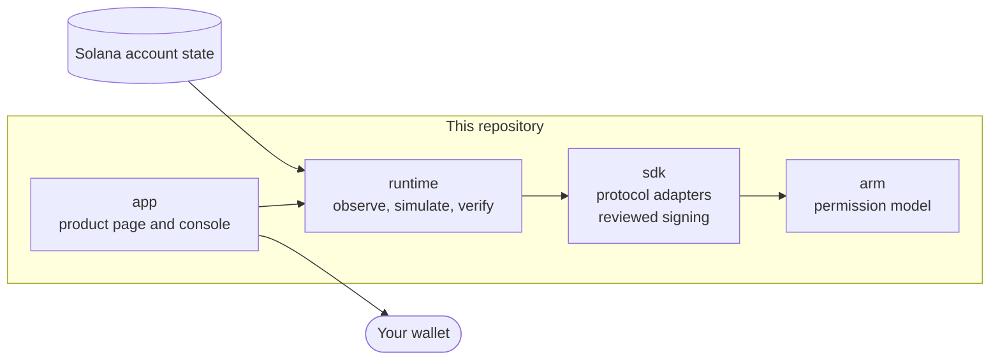

# Velon

Know who can act on your Solana assets. Take back control, with proof.

When you approve an app to spend your tokens, that approval stays on chain after you
close the tab. Velon reads those permissions from native account state, explains them
in plain words, lets you revoke one, and then checks the chain again to prove it is gone.

**Try it:** https://velon-eta.vercel.app. No login or wallet needed: grant yourself a test
permission and revoke it on a hosted test validator, or browse recorded native evidence.

## What it does

1. **Observe.** Reads finalized account state and turns each supported permission into
   one sentence: who can act, on which account, for how much.
2. **Review.** Builds the revoke transaction and simulates it against the same finalized
   state, so you see exactly what will be removed before you sign.
3. **Sign.** Your wallet signs the reviewed bytes. If a wallet changes the message,
   Velon refuses to send it.
4. **Verify.** Waits for finality, reads the account again and confirms the permission
   is gone. Only then does it say "Revoked".
5. **Receipt.** Keeps the signature, finalized slot and a verification ID. The proof
   can be replayed later without the chain.

## What works today

| Area                               | Status                                                               |
| ---------------------------------- | -------------------------------------------------------------------- |
| SPL Token delegate: observe        | Works against a live chain                                           |
| SPL Token delegate: revoke + proof | Works end to end on a local Solana validator, with real wallet signing |
| Solana Subscriptions               | Read-only, from accounts captured by executed native tests           |
| Squads V4 token spending limits    | Adapter in the SDK, tested by running the mainnet program locally    |
| Revoke on devnet and mainnet       | Not enabled yet (see Limits)                                         |

## How the pieces fit



| Folder     | What it is                                                                                                                             | Language         |
| ---------- | -------------------------------------------------------------------------------------------------------------------------------------- | ---------------- |
| `arm/`     | The permission model. A protocol-neutral way to say "this key can do this, to that, within these limits". No RPC, no program IDs.        | Rust             |
| `sdk/`     | Adapters that turn native accounts into that model (SPL Token, Subscriptions, Squads V4) and the browser helper that signs only reviewed bytes. | Rust, TypeScript |
| `runtime/` | The service that observes finalized state, checks that the deployed program is the one it understands, simulates revokes and verifies results. | Rust             |
| `app/`     | The product page and the console people use.                                                                                           | TypeScript, Bun  |

Each folder has its own README with the details. This repository combines four
repositories with their history: `catalyst-demo` (app), `cataloger` (runtime),
`catalyst-sdk` (sdk) and `catalyst-crank` (arm).

## Run it

Requirements: Bun 1.3.14 or newer, Node 22, npm, Git and stable Rust.

The app refuses to start unless the runtime is checked out at the exact commit it was
tested with. `runtime/` in this repository is that code, but the check reads a Git
commit, so the app needs the runtime as its own checkout:

```sh
git clone https://github.com/dakewamama/velon.git
cd velon
git clone https://github.com/dakewamama/cataloger.git .cataloger
git -C .cataloger checkout 3ececf3f1a88542f07af2fc770683a43c6caaa69

cd app
npm ci --ignore-scripts
CATALOGER_DIR="$PWD/../.cataloger" bun run demo
```

Open http://127.0.0.1:3000. The first run builds the runtime in release mode, which
takes a few minutes. This mode shows recorded native evidence and needs no RPC key.

### The full revoke journey

The revoke flow needs a local validator running Agave 3.1.10, the version the runtime
executes programs with. Download that release, then:

```sh
cd app
AGAVE_BIN=/path/to/agave-3.1.10/bin CATALOGER_DIR="$PWD/../.cataloger" bun run local
```

It starts the validator with the real mainnet SPL Token program, creates a token
account with a delegate, and prints the exact command to start the app against it.
In the console, choose "Use a test wallet" to grant a permission and revoke it without
installing anything, or connect Phantom or Solflare.

## Tests

| Folder     | Command                                               | What runs                                           |
| ---------- | ----------------------------------------------------- | --------------------------------------------------- |
| `app/`     | `npm test`, `npm run test:e2e`                        | 22 unit tests, 48 browser tests on desktop, tablet and phone |
| `app/`     | `npx playwright test -c playwright.live.config.ts`    | 6 tests against a real local validator, including a full revoke |
| `runtime/` | `cargo test --locked`                                 | 108 tests                                           |
| `sdk/`     | `cargo test --locked`, `bun test`                     | 89 Rust tests, 48 TypeScript tests                  |
| `arm/`     | `cargo test --locked`                                 | Model and evaluation tests                          |

The browser tests in `app/tests/browser` use a controlled RPC so failures are
repeatable. Nothing from them is shown in the product or presented as chain evidence.

## Limits

- **Public networks.** Velon only issues a transaction to sign when it has executed
  the deployed program itself and matched the result. That executor is pinned to
  Agave 3.1.10. Devnet and mainnet run newer versions, so revoke is switched off there
  until the executor is updated. Reading permissions is not affected.
- **Coverage.** Velon shows the permission systems listed above, not every way an
  account can be controlled. Anything it cannot fully read is marked unsupported
  instead of guessed.
- **Amounts** are shown in base units. Velon does not infer token symbols or decimals.
- **The hosted test bench** runs the local-validator setup on a remote sandbox. It is a
  disposable test ledger, not devnet, and is rate limited per visitor. See
  `app/README.md` for how it is wired.
