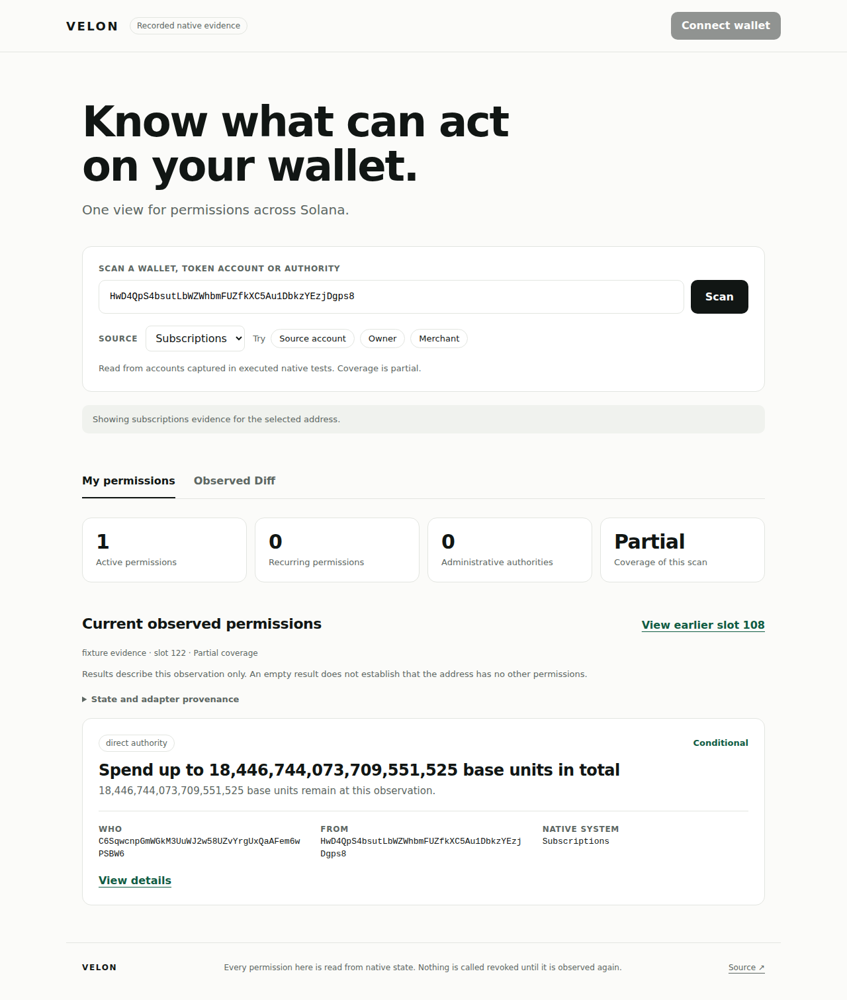

# Catalyst demo

Velon: one view of what can act on a Solana wallet, read from native state.
This is the Velon showcase. ARM, Cataloger and Catalyst keep their own repositories.

The demo runs the pinned Cataloger CLI, imports accounts captured by executed native
tests and serves its real journal API. The browser interprets ARM 0.1 responses.
No balances, permissions or transaction outcomes are fabricated for the interface.



## Run

Requirements: Bun 1.3.14 or newer, Node 22, npm, Git and stable Rust.

```sh
git clone https://github.com/dakewamama/cataloger.git ../cataloger
git -C ../cataloger checkout 3ececf3f1a88542f07af2fc770683a43c6caaa69
npm ci --ignore-scripts
bun run demo
```

Open `http://127.0.0.1:3000`. For an existing checkout, set
`CATALOGER_DIR=/absolute/path/to/cataloger`. Its tracked files must match the pinned
revision. The first run builds `authorization-api` in release mode; later builds reuse Cargo's cache.
The local fixture journal lives in ignored `.data/observations-{cataloger_revision}.db`.
Each runtime pin gets its own journal so older projection evidence remains intact.
No RPC credential is required for fixture replay.
`PORT` and `RUNTIME_PORT` select the browser and observation API ports respectively.
Both bind to localhost by default. `HOST` changes only the browser server's bind address.

For bundled assets:

```sh
npm run build
bun run start
```

## What the evidence proves

Subscriptions fixtures retain two observations of the same target at slots 108
and 122. The earlier observation contains merchant/puller authority with a shared
recurring allowance. The later observation follows cancellation and delegation
revocation. That derived spend grant disappears while technical and administrative
authority remain independently observable. Select Merchant, then View earlier slot
108, to inspect the shared allowance and its parent grant.

Observed Diff compares these two whole ARM projections. It omits changing evidence
references from semantic equality while retaining the complete original records.
The interval includes several native transitions. It is not a predicted transaction
diff or proof that all changes were caused by one instruction. Different scopes,
unordered slots, failed projections and duplicate grant identities are rejected.

The SPL fixture demonstrates the same Scan and Detail views through another adapter.
Native amounts stay in integer base units. The demo does not infer a mint symbol or
decimal scale. Integers are parsed losslessly, including values above JavaScript's
safe integer range. Compound principals retain one shared grant and allowance.

Every view identifies its state version, observed slot, partial coverage, deployment,
adapter and evidence. Current means latest observed state in this fixture scope.
It does not claim complete address discovery or live freshness. Unknown, incomplete
and invalid projections suppress permissions. Derived availability remains unknown
where the generic ARM evaluator cannot prove dependencies.

## Verification

```sh
npm run format:check
npm run typecheck
npm test
npm run build
node_modules/.bin/playwright install chromium --only-shell
npm run test:e2e
```

Browser tests run against the real imported journal on desktop, tablet and mobile.
They cover shared allowances, native u64 amounts, retained administrative authority,
removed derived authority, evidence inspection, partial coverage, invalid input,
empty results, provider failure and conflicting/unsupported observations. Screenshots
and traces remain under ignored `test-results/`.

## Revoke API bridge

The browser server forwards these existing Cataloger routes:

- `POST /api/scopes/{scope_id}/actions/revoke/{token_account}` observes the scope's
  current finalized bank and requests simulation in that same bank.
- `POST /api/snapshots/{id}/actions/revoke/{token_account}/verify` forwards the
  signed transaction for finalized verification and native reobservation.
- `GET /api/verifications/revoke/{verification_id}` retrieves retained evidence.

POST requests require `X-Velon-Action: revoke`. Simulation accepts no body;
verification requires `application/json` containing `signed_transaction`, as defined
by Cataloger. Request bodies are limited to 4096 bytes. The server preserves raw
response bytes and status codes, rejects query strings and redirects, and never sends
transactions or forwards browser credentials. The action header prevents cross-origin
browser requests without preflight; it is not client authentication.

Set `RPC_URL` for Cataloger's action endpoints. They remain unavailable without it.
The imported fixtures alone do not establish live authority. Cataloger still requires
verified deployment/runtime evidence and current state before returning signing bytes.
A 404 during finalization remains pending or absent, not a successful revocation.
The browser connects through Wallet Standard and requires `solana:signTransaction`.
It passes the reviewed bytes through Catalyst's pinned signing/submission helper.
Changed messages, invalid signatures, expired blockhashes and changed checkpoints
stop submission. A send response alone never produces a success screen: verification
must succeed, the current scope must agree, and the grant must be absent after reload.

## Wallet control

Fixture scenarios remain read-only. With `RPC_URL` set, the demo adds one live
scenario that observes a classic SPL token account on request:

```sh
RPC_URL=<server-rpc-url> \
PUBLIC_RPC_URL=<browser-safe-rpc-url> \
LIVE_NETWORK=localnet \
LIVE_CATALOG=/absolute/path/catalog.json \
LIVE_SOURCE=<optional-example-token-account> \
CATALOGER_DIR=/absolute/path/to/cataloger bun run demo
```

`/` is the product page and `/app` is the console. On a local validator the server
also lists the token accounts the chain reports as delegated right now
(`GET /api/live/spl/delegated`), which both pages poll; that list is discovery, and
selecting an entry observes it through Cataloger before anything is shown as a
permission. With `LIVE_TEST_BENCH=1` and `AGAVE_BIN` set, the console can approve a
fresh delegate allowance for the local demo owner (`POST /api/live/spl/approve`), so a
revoked permission can be recreated without leaving the page. The same switch lets a
visitor test with their own key: `POST /api/test/account` sends a wallet SOL for fees
and a token account with test tokens, the wallet then signs an ordinary SPL approval,
and the revoke that follows goes through the full reviewed flow. "Use a test wallet"
creates a throwaway key in the page for visitors with no extension. Verified revokes
are kept in the browser and can be replayed from the journal under Receipts. These
routes exist only for `LIVE_NETWORK=localnet`.

Setting `MAINNET_RPC_URL` (or `DEVNET_RPC_URL`) adds a list of the newest token
delegations on that cluster (`GET /api/mainnet/delegated`): the server reads recent
finalized blocks for approve instructions and keeps up to five accounts whose delegate
is still in force and whose owner is a wallet. Blocks are read only while someone has
asked for the list in the last two minutes. On the console's own cluster, choosing a row
observes the account and opens the verified review; on another cluster the row is
shown as the RPC reports it, unverified. A provider URL with a key belongs in the
environment only, never in the repository.

`POST /api/live/spl/observe` accepts `{"source":"<token account>"}` and nothing else.
The server validates the address, asks the RPC which owner and delegate accounts the
token account names, and runs Cataloger's `observe` with one `spl_delegate` target and
those witnesses. Cataloger reads the finalized batch and the cluster's activated feature
accounts at that slot, decodes them and journals the record; the browser never decodes
account data. `POST /api/live/wallet` reads a wallet's SOL balance and token accounts
for display, and classifies any address as a wallet, a token account, a mint or
something else. Startup resolves the genesis hash behind `RPC_URL`, captures the SPL
Token program and the cluster's features into a catalog (or uses `LIVE_CATALOG`), and
refuses to start unless the program is the verified build. The catalog is captured
again every hour, because a record is valid for one epoch and a feature activation at
an epoch boundary retires it early. `PUBLIC_RPC_URL` is exposed to the browser, so never
put a private provider credential there; use `RPC_RELAY=1` with `PUBLIC_RPC_URL` set to
the app's own `/rpc` instead.

Connect the token-account owner's wallet, observe the account and choose Revoke.
Revoke asks Cataloger to observe the account again, execute the revoke itself against
that finalized bank and require a provider simulation (from that bank or a later one)
to reach the same account bytes. It then shows that fresh state for review and refuses
to open if the permission differs from the one scanned; nothing is signed otherwise.
After signing, the pinned Catalyst helper submits the exact reviewed bytes and the
browser polls verification without resending. The success screen needs a finalized
receipt, a newer observation and the grant's absence from current state.

### Local validator

The runtime executes programs with the pinned Agave 4.3.2 crates, configured from the
cluster's own activated features. A local validator from the same release gives a
complete loop with nothing at stake:

```sh
AGAVE_BIN=/path/to/agave-4.3.2/bin bun run local
```

The script checks the validator's revision, loads the token program and ProgramData
from Cataloger's retained finalized mainnet capture, creates an owner, mint and token
account, approves a delegate for 25 base units and writes the catalog with executable
identity and runtime evidence for that genesis. It prints the launch command above.
`AGAVE_BIN=... bun run local:reset` approves the same delegate again on the running
ledger, keeping earlier receipts and the journal. Rerunning `local` starts a new
ledger and genesis, so the demo must be restarted with the newly printed command.
Then, with the demo running:

```sh
LIVE_OWNER_KEYPAIR=.data/local/owner.json RPC_URL=http://127.0.0.1:8899 npm run test:live
```

A browser signs with the owner key against the running validator. The test first
rejects in the wallet, then returns a signature over altered bytes, and confirms
that the page sent no transaction and the delegate is untouched both times. It then signs the reviewed
bytes, the validator executes the revoke, and the test confirms the finalized
transaction and the cleared delegate through RPC independently of the page.

### Hosted test bench

https://velon-eta.vercel.app runs this local-validator setup on a remote sandbox, so
visitors can grant and revoke on it without installing anything. It is a disposable
test ledger, labelled as such, not devnet. `deploy/supervisor.py` starts the validator,
demo and `deploy/gateway.ts`, runs the checksummed `authorization-api` named in
`artifacts.json` (with the commit it was built from) and announces startup only once the
gateway's `/healthz` answers. With `VELON_NETWORK=mainnet` and a private
`UPSTREAM_RPC_URL` it starts no validator and serves mainnet instead; the provider URL
stays in that process tree. Run the supervisor under a restart policy: it exits non-zero
when any child stops.

The gateway allows only the RPC methods the console needs, refuses `getAccountInfo`
requests for account data and any `/rpc` call without the console's `X-Velon-Action:
rpc` header, and limits grants, revokes, transactions, observations, wallet reads and
RPC calls per visitor (IPv6 by /64) and in total. It logs one line per request with a
hashed visitor id. The static export (`HOSTED_RUNTIME=1 npm run export`) serves the
pages, and `scripts/hosted-proxy.cjs` forwards `/api` and `/rpc` to the gateway for the
hosts in `PUBLIC_HOSTS` only, with a server-only token and the visitor address Vercel
observed. No credential reaches the browser.

The control tests under `tests/browser` register an ephemeral
wallet and use synthetic RPC responses; they prove browser conformance for failure
cases that cannot be staged on a chain, not chain execution.

## Scope

The default browser mode replays native fixtures. An explicitly configured finalized
SPL scope enables wallet control through existing runtime and SDK APIs. Live public
execution, continuous collection/repair, general transaction Diff, Squads, Swig and
exact intent compilation remain separate milestones. No claim
is made that this repository already implements the full cross-protocol closed loop
or that no other public or private implementation exists.

Sources and reuse decisions are recorded in [SOURCE_LEDGER.md](docs/research/SOURCE_LEDGER.md).
